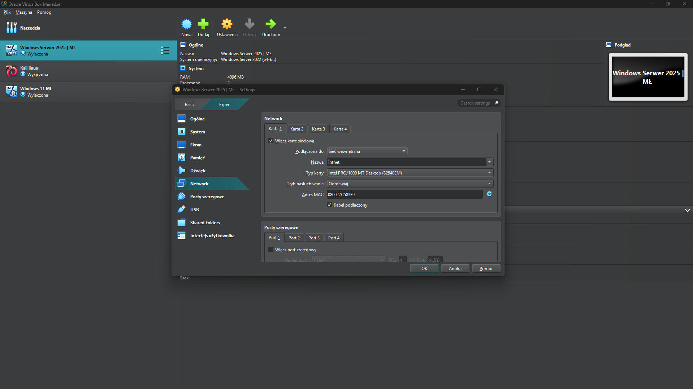
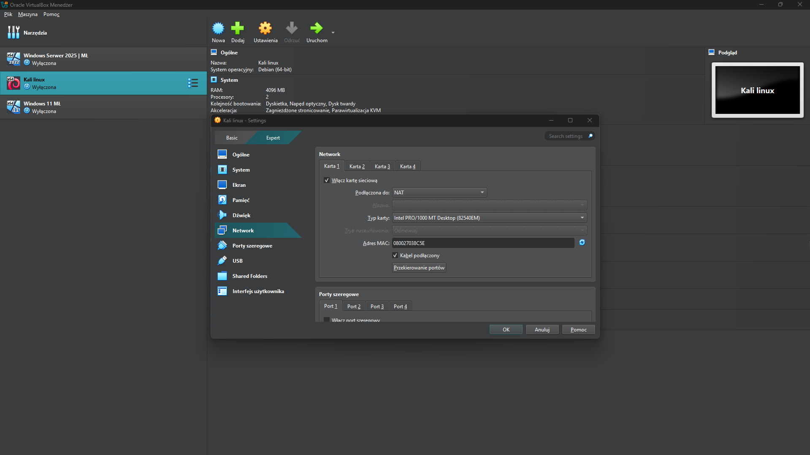
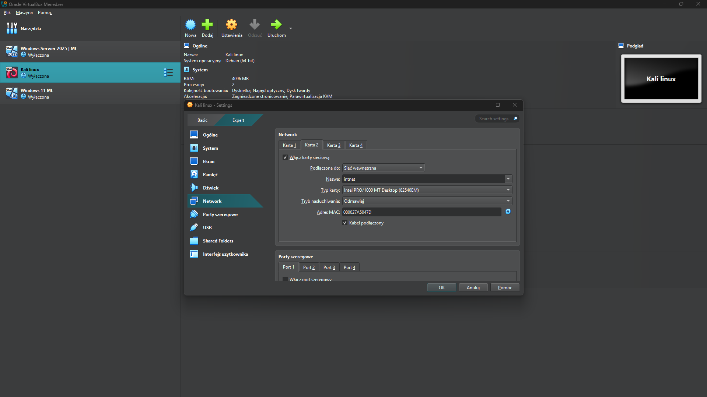
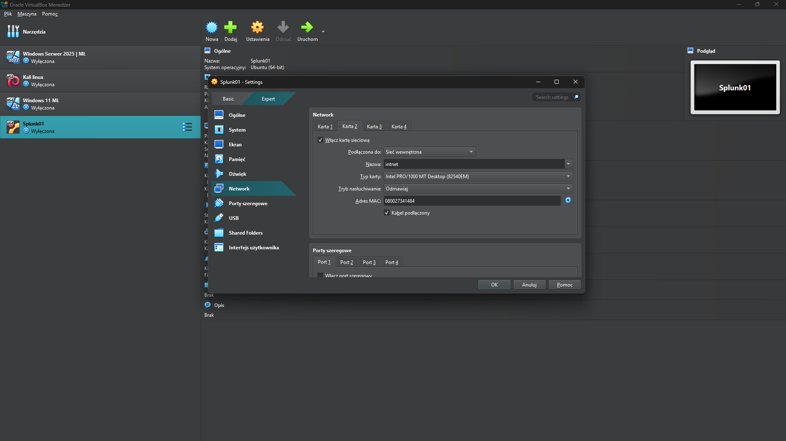
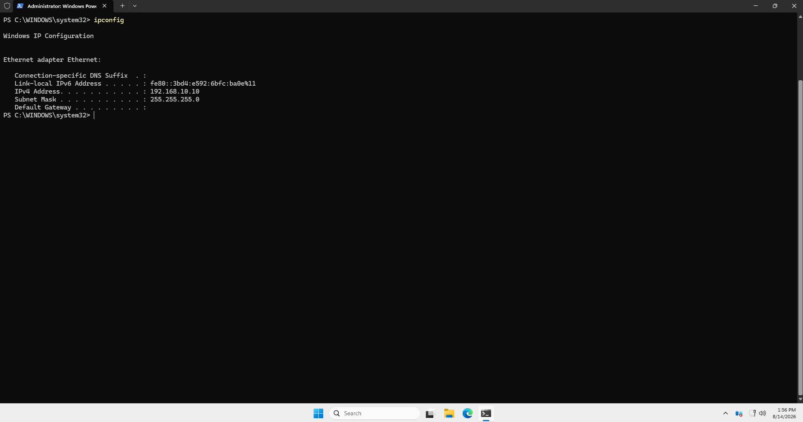
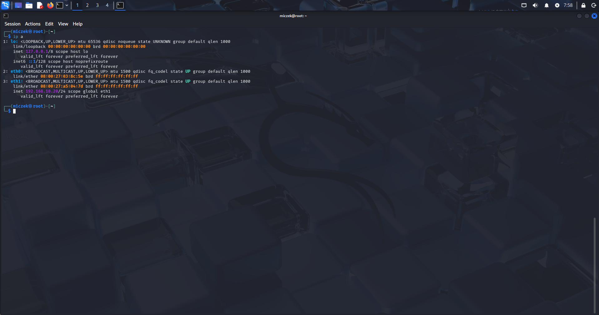
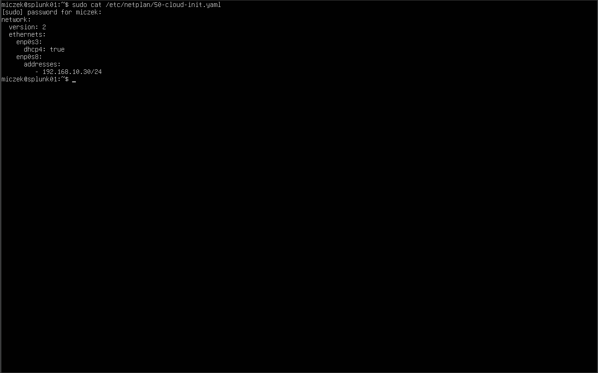
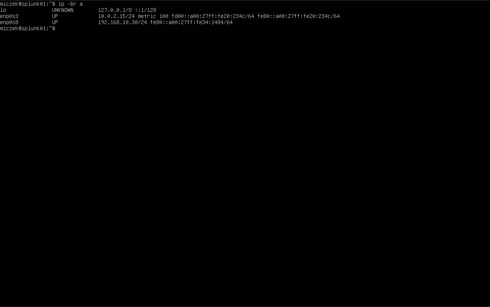
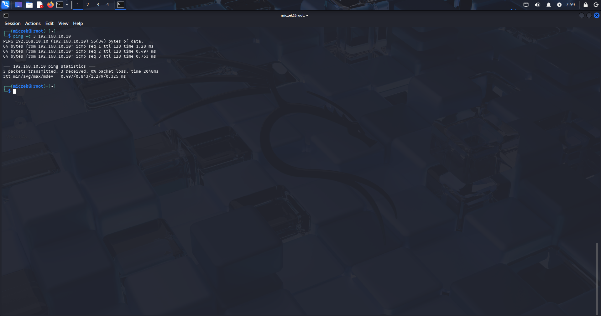
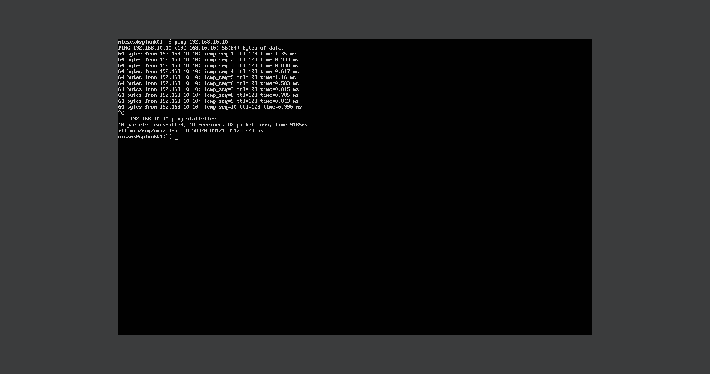

# 01 - Network Setup

This document covers the VirtualBox network configuration used to build an isolated lab environment for the Domain Controller (DC01), the attacker machine (Kali Linux) and the SIEM server (Splunk01).

## 1. Network Architecture

The lab uses VirtualBox's **Internal Network** mode, named `intnet`. Internal Network traffic is visible only between VMs attached to the same network name — there is no route to the host machine, the home network, or the internet. This guarantees the lab stays fully isolated, which matters for two reasons:

- Attacks performed later in this project (Kerberoasting, LLMNR/NBT-NS Poisoning) never touch anything outside the lab
- The environment is fully reproducible and safe to experiment in without any risk to other devices on the network

| Machine | Role | Adapter | Network mode | IP Address |
|---|---|---|---|---|
| DC01 (Windows Server 2025) | Domain Controller | Adapter 1 | Internal Network (`intnet`) | 192.168.10.10 |
| Kali Linux | Attacker | Adapter 1 | NAT | (dynamic, internet access) |
| Kali Linux | Attacker | Adapter 2 | Internal Network (`intnet`) | 192.168.10.20 |
| Splunk01 (Ubuntu Server 24.04 LTS) | SIEM | Adapter 1 | NAT | (dynamic, internet access — used only during setup) |
| Splunk01 (Ubuntu Server 24.04 LTS) | SIEM | Adapter 2 | Internal Network (`intnet`) | 192.168.10.30 |

## 2. Domain Controller — Network Adapter

DC01 uses a single adapter attached to the Internal Network `intnet`.



## 3. Kali Linux — Dual Adapter Setup

Kali Linux uses **two** network adapters:

- **Adapter 1 — NAT**: provides outbound internet access, used only for installing and updating tools (e.g. `apt update`, `pip install --upgrade impacket`). This adapter has no route to the lab network and plays no part in the attacks themselves.
- **Adapter 2 — Internal Network (`intnet`)**: the actual lab network, used to communicate with DC01 and carry out attacks.





**Why two adapters instead of one:** Internal Network has no internet access by design — that's the entire point of using it. Rather than repeatedly switching a single adapter between NAT and Internal Network (and risking forgetting to switch back before an attack), a second, dedicated adapter keeps both connections available at once without compromising the isolation of the lab network.

## 4. Splunk01 — Dual Adapter Setup

Splunk01 follows the same two-adapter pattern as Kali Linux:

- **Adapter 1 — NAT**: provides outbound internet access, used only to download installers during setup (for example the Splunk Enterprise package). It plays no part in log collection.
- **Adapter 2 — Internal Network (`intnet`)**: the actual lab network. DC01 will send its logs to Splunk01 over this link.




**Why a separate machine for Splunk:** the logs are stored on Splunk01 instead of on the monitored host. This way, an attacker who gets onto DC01 cannot easily tamper with the evidence.

## 5. Verifying IP Configuration

### Domain Controller

```powershell
ipconfig
```

Confirms DC01 holds `192.168.10.10` on its Ethernet adapter.



### Kali Linux

```bash
ip a
```

Confirms Kali holds `192.168.10.20/24` on `eth1` (the Internal Network adapter), separate from `eth0` (NAT).



**Note:** the static IP on `eth1` occasionally resets after the interface is reconnected or the NetworkManager service restarts. If `ip a` shows no IPv4 address on `eth1`, it can be reassigned manually:

```bash
sudo nmcli connection add type ethernet ifname eth1 con-name lab-static ipv4.method manual ipv4.addresses 192.168.10.20/24
sudo nmcli connection up lab-static
```

### Splunk01

Ubuntu Server sets its network in a Netplan configuration file: `/etc/netplan/50-cloud-init.yaml`. In this file, `enp0s3` (the NAT adapter) gets its address from VirtualBox automatically, and `enp0s8` (the Internal Network adapter) is given a fixed address: `192.168.10.30/24`.



After saving the file, the new settings are applied with:

```bash
sudo netplan apply
```

Then `ip a` shows the result:

```bash
ip a
```

Confirms Splunk01 holds `192.168.10.30/24` on `enp0s8` (the Internal Network adapter), separate from `enp0s3` (NAT, `10.0.2.15`).



## 6. Connectivity Test

### Kali → DC01

With Kali and DC01 configured, connectivity between them was confirmed with a simple ping test:

```bash
ping -c 3 192.168.10.10
```

Result: 3/3 packets received, 0% packet loss — confirming the Internal Network link between both machines is functional.



### Splunk01 → DC01

The same test was done from Splunk01:

```bash
ping 192.168.10.10
```

The test was stopped manually (`Ctrl+C`) after 10 packets. Result: 10/10 packets received, 0% packet loss, average round-trip time 0.891 ms — confirming the Internal Network link between Splunk01 and DC01 is functional. This is the link the Windows event logs will travel over later.



## Status

✅ Isolated Internal Network (`intnet`) configured and verified between DC01 and Kali Linux.

✅ Splunk01 added to `intnet` with the static IP `192.168.10.30` and verified against DC01.

**Next step:** Install Active Directory Domain Services and promote DC01 to the first Domain Controller in a new forest (see `02-domain-controller-setup.md`).

*Splunk01 was added to the network after the rest of the lab was built. Its Splunk Enterprise setup continues in document 07 (Splunk SIEM Setup).*
