# 06 - Detection (Blue Team)

This document covers the Blue Team side of the two attacks performed earlier in this project: Kerberoasting (`04-kerberoasting-attack.md`) and LLMNR/NBT-NS Poisoning (`05-llmnr-poisoning-attack.md`), analyzed from DC01. The goal was to find what evidence each attack leaves behind, why that evidence is easy to miss, and to test a real fix rather than just describe one.

## Track 1: Kerberoasting (Event 4769)

### 1. Context
- **Source attack:** `04-kerberoasting-attack.md`
- **Log analyzed:** Security log on DC01, Event ID 4769 ("A Kerberos service ticket was requested")
- **Requesting account:** `jkowalski` (legitimate domain credentials, known to the attacker)
- **Target service:** `svc-sql`

Kerberoasting doesn't exploit a bug — it abuses a normal, documented Kerberos feature. Any authenticated domain user can request a service ticket for any service with a registered SPN, no questions asked. The goal of this track was to find what that normal-looking request actually looks like in the logs.

### 2. Confirming Auditing Was On
Before looking for evidence, it's worth checking whether the right auditing was even enabled:

```powershell
auditpol /get /category:"Account Logon"
```

```
Category/Subcategory                    Setting
Account Logon
  Credential Validation                   Success
  Kerberos Authentication Service         Success
  Kerberos Service Ticket Operations      Success
  Other Account Logon Events              No Auditing
```

`Kerberos Service Ticket Operations: Success` was already enabled — this subcategory is what generates Event 4769 every time a client requests a service ticket.

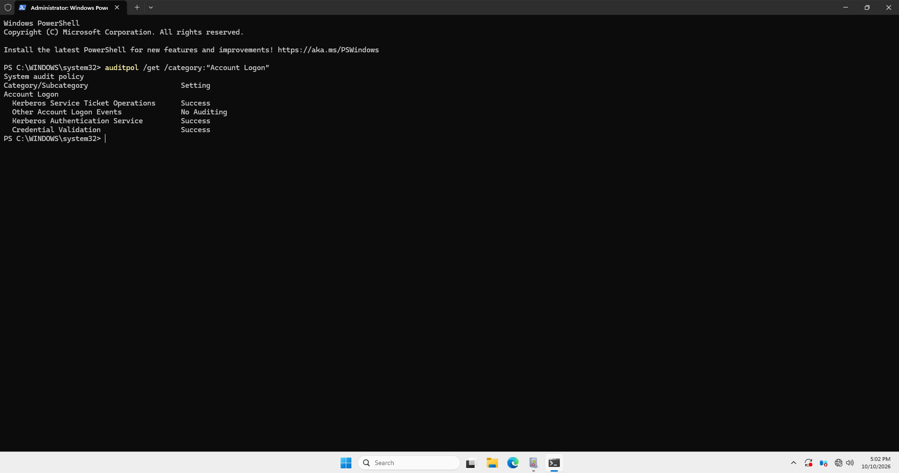

### 3. Finding the Attack in the Security Log
Filtering the Security log by Event ID 4769 turned up four separate requests, all from `jkowalski` for `svc-sql`, within about 14 minutes:

| # | Time (8/11/2026) |
|---|---|
| 1 | 5:34:54 PM |
| 2 | 5:36:14 PM |
| 3 | 5:45:06 PM |
| 4 | 5:48:39 PM (successful) |

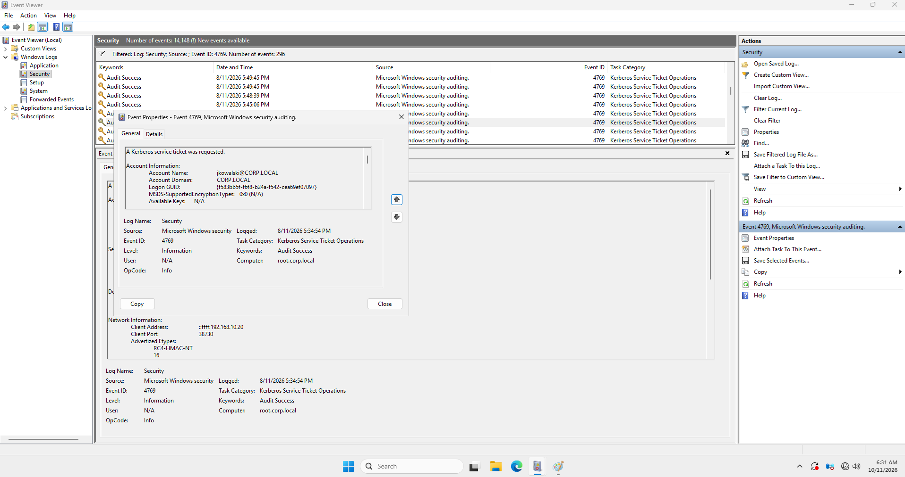


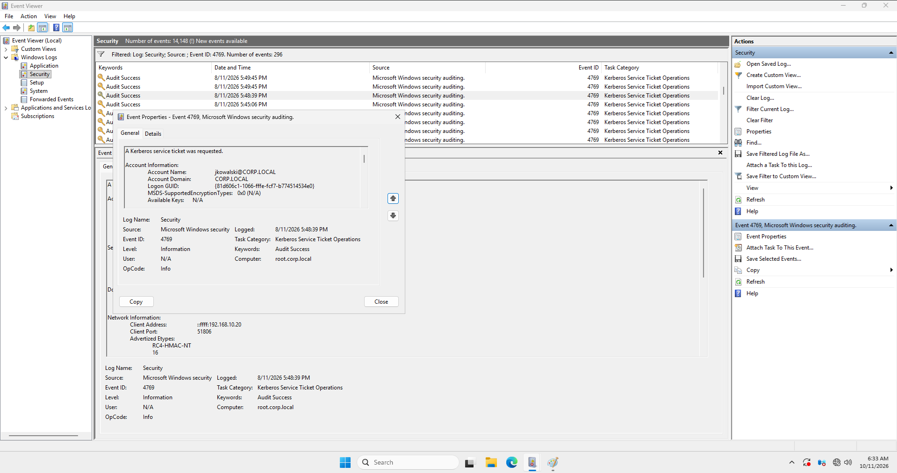

The last event, in full:

```
Account Name:     jkowalski@CORP.LOCAL
Service Name:     svc-sql
Client Address:   ::ffff:192.168.10.20   (Kali)
Ticket Encryption Type: 0x12   (AES256)
Advertized Etypes:
    RC4-HMAC-NT
    DES-CBC-MD5
    AES256-CTS-HMAC-SHA1-96
```

### 4. Why Encryption Type Doesn't Give It Away Here
`svc-sql` has `msDS-SupportedEncryptionTypes=24` (AES only), so the Domain Controller forces AES256 for every ticket request for this account — legitimate or not. The classic Kerberoasting red flag ("look for RC4, etype 0x17") does not apply in a hardened environment like this one, because every ticket for this account shows `0x12` regardless.

### 5. What Actually Stands Out
Two things don't fit a normal client:

- **Advertized Etypes** lists `RC4-HMAC-NT` and `DES-CBC-MD5` alongside AES256 — old, weak types a real modern Windows client would not normally offer. This is a side effect of how the attack tool (Impacket's `GetUserSPNs`) builds its request: for compatibility, it advertises everything it supports, old and new.
- **Repetition:** four requests for the same service from the same account inside 14 minutes. A real business process requests a ticket once and reuses it for hours, not repeatedly in quick succession.

### 6. Why This Attack Is Hard to Detect
Event 4769 is not suspicious by itself — it's a normal part of how Kerberos works. The Domain Controller never checks if the account asking for a ticket actually has a real reason to use that service. Cracking the password happens offline, on the attacker's own computer, so Windows never sees it and can't log it. The only thing that shows up in the logs is the request itself — so detection must focus on the pattern of requests, not on the cracking.

### 7. Mitigation
The best fix is a strong, long password for the service account — this makes offline cracking much harder. Changing the password by hand every month helps a little, but it depends on a person remembering to do it. A better fix is a Group Managed Service Account (gMSA): Active Directory creates a random password (120+ characters) on its own and rotates it automatically, usually every 30 days, with no person ever seeing or typing it — making offline cracking realistically impossible.

`svc-sql` in this lab is deliberately a normal service account, not a gMSA — that's why cracking it worked in `04-kerberoasting-attack.md`. In a real environment, it should be a gMSA instead.

## Track 2: LLMNR / NBT-NS / mDNS Poisoning

### 1. Context
- **Source attack:** `05-llmnr-poisoning-attack.md`
- **Log analyzed:** `Microsoft-Windows-NTLM/Operational` on DC01, Event ID 4020
- **Trigger:** `ls \\losowanazwa123\test`, same as in doc 05

Unlike Kerberoasting, Windows has no Security log event that says "a broadcast name request was answered by an unexpected host." The poisoning itself happens entirely at the network level, outside of what Windows logs by default — evidence has to be found indirectly.

### 2. Finding the NTLM Fallback
One place that sometimes catches a trace: **Applications and Services Logs → Microsoft → Windows → NTLM → Operational**. Filtering to the time of the attack in doc 05 found Event 4020:

```
Username: Administrator
Target Network Name: losowanazwa123
Target IP: fe80::1ff7:8260:950c:4bc8
```

> Reason: The target name could not be resolved by Kerberos or other protocols.

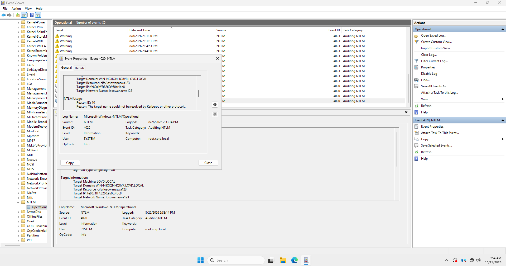

`losowanazwa123` is the exact name used in the `ls` command from doc 05, and the target IP matches Responder's own address from that same document.

### 3. What This Event Actually Shows
The `Reason` field explains the whole attack in one sentence: DNS could not resolve the name, so Windows fell back to a local network broadcast — and trusted the first machine that answered, with no way to check who actually answered. That fallback-and-trust behavior is the real vulnerability, not any single misconfiguration.

### 4. Testing the Fix — Partial Fix Was Not Enough
The obvious fix is disabling LLMNR and NBT-NS, the two protocols most guides mention:

- GPO: `Computer Configuration → Administrative Templates → Network → DNS Client → "Turn off multicast name resolution"` → **Enabled** (disables LLMNR)
- Network adapter → IPv4 → Advanced → WINS tab → **Disable NetBIOS over TCP/IP** (disables NBT-NS)
- `gpupdate /force` to apply immediately

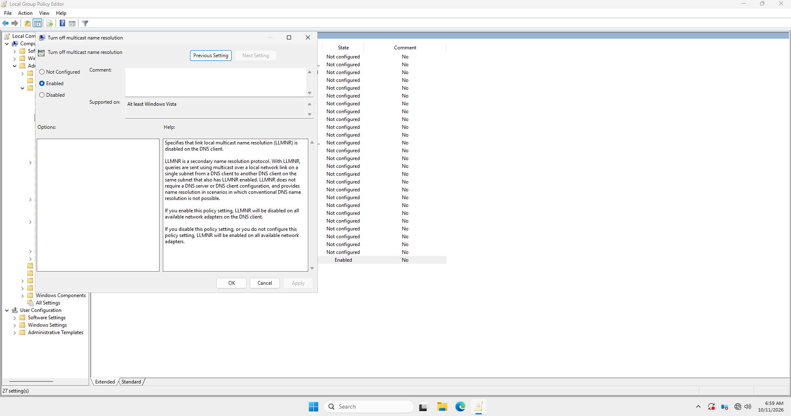
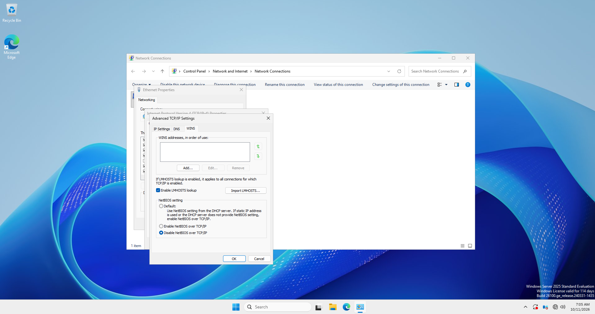
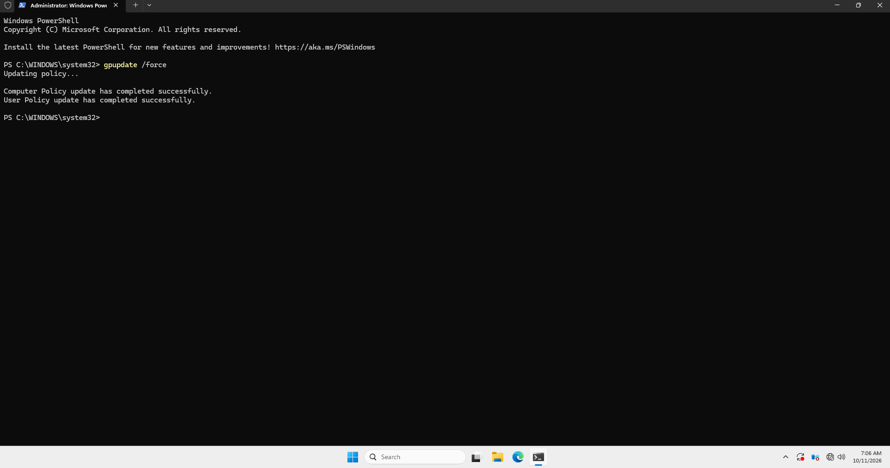

Repeating the exact attack from doc 05 after this change still partially worked:

```
[*] [MDNS] Poisoned answer sent to 192.168.10.10 for name losowanazwa123.local
[*] Skipping previously captured hash for CORP\Administrator
```

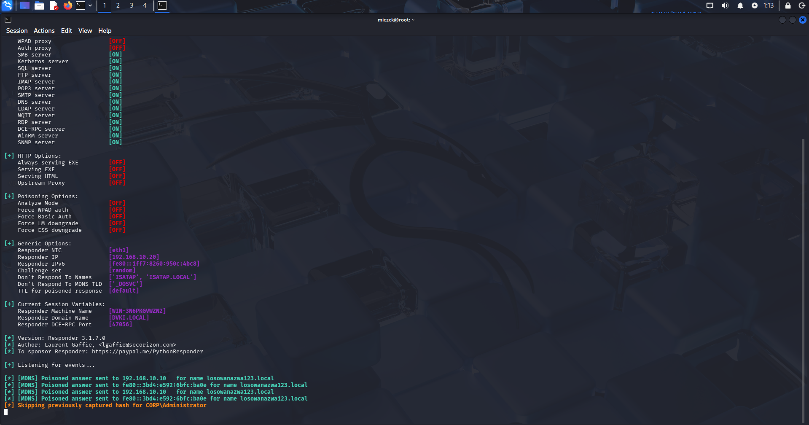
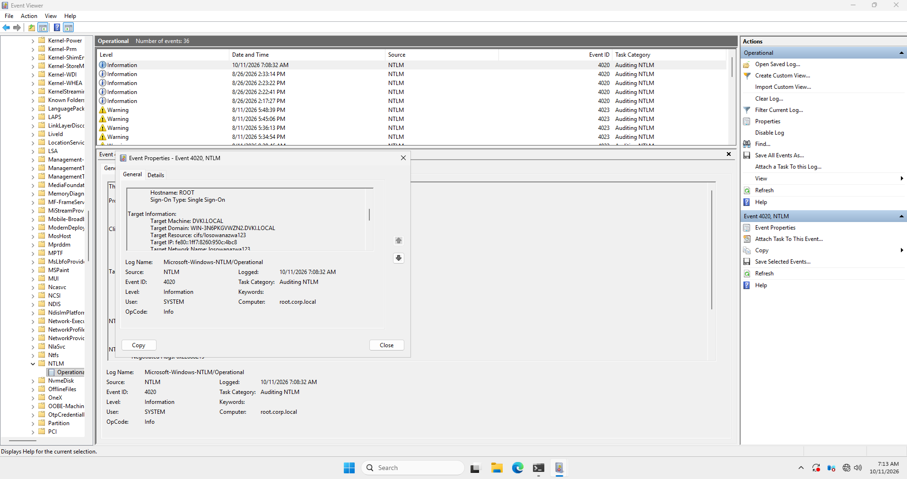

A third protocol, **mDNS** (Multicast DNS), was never touched — and because the lab domain is `corp.local`, its `.local` suffix matches exactly what mDNS resolves. Unlike LLMNR and NBT-NS, mDNS is not a legacy protocol being phased out — it's the newer standard Microsoft added in Windows 10 1703+, which is why it has no simple "Enabled" checkbox in Group Policy the way LLMNR does.

### 5. Full Fix
Disabling mDNS requires a registry value:

```
Key:   HKLM\SYSTEM\CurrentControlSet\Services\Dnscache\Parameters
Name:  EnableMDNS   (DWORD)
Value: 0
```

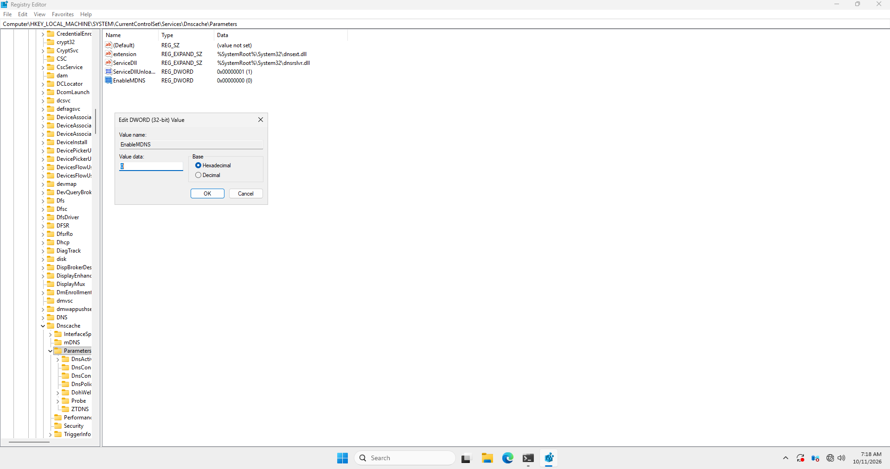

A restart is needed to apply it. Repeating the attack one more time: Responder stayed completely silent, and DC01 returned a single clean error instead of two:

> ls : Cannot find path '\\losowanazwa123\test' because it does not exist.

No `Access is denied` line this time — meaning no authentication attempt was made at all. Event Viewer confirmed it: no new Event 4020.

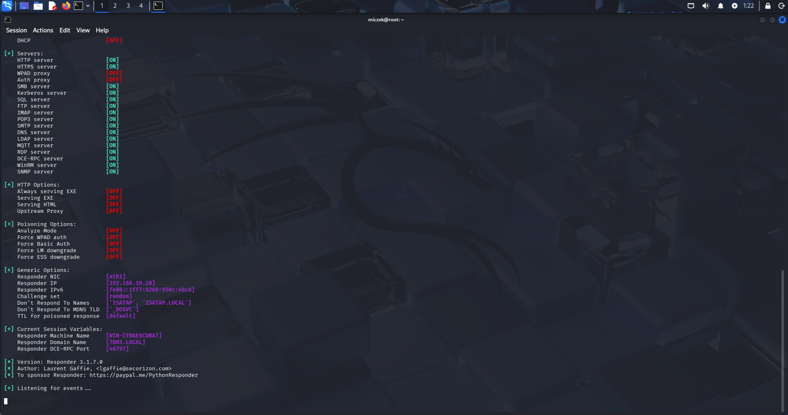
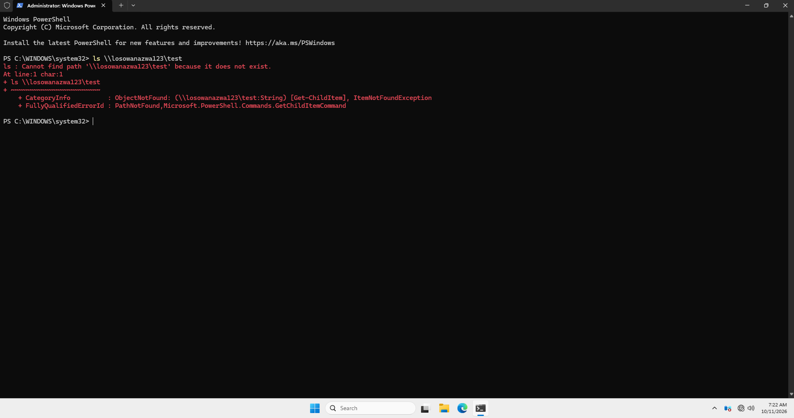

### 6. Key Lesson
Disabling only LLMNR and NBT-NS — the two protocols most pentesting guides focus on — is not enough on a modern Windows Server. Full protection against this attack class requires disabling all three broadcast name resolution protocols: LLMNR, NBT-NS, and mDNS. This is also consistent with Microsoft's broader direction: NTLM itself, the protocol this whole attack is designed to steal, is being phased out and disabled by default in newer Windows Server and Windows 11 releases, in favor of Kerberos.

## Status
✅ Kerberoasting: event found → encryption-type heuristic shown ineffective → pattern-based signals identified → mitigation (gMSA) documented.
✅ LLMNR/NBT-NS/mDNS: event found → partial fix tested and shown insufficient → full fix tested and verified end-to-end.

This closes the attack/defense cycle for both techniques covered in this project.