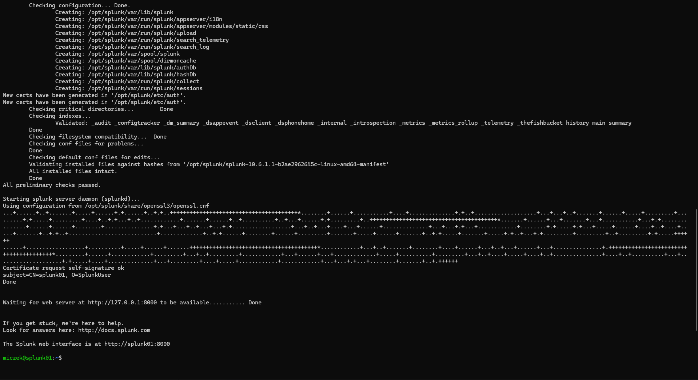
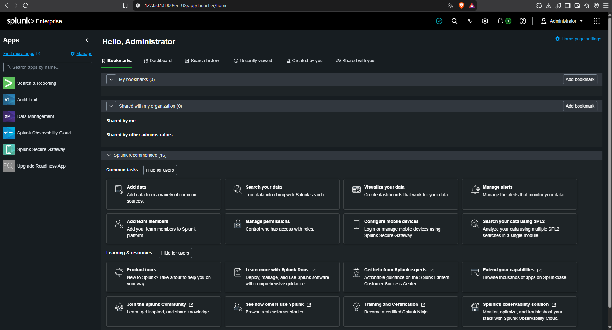
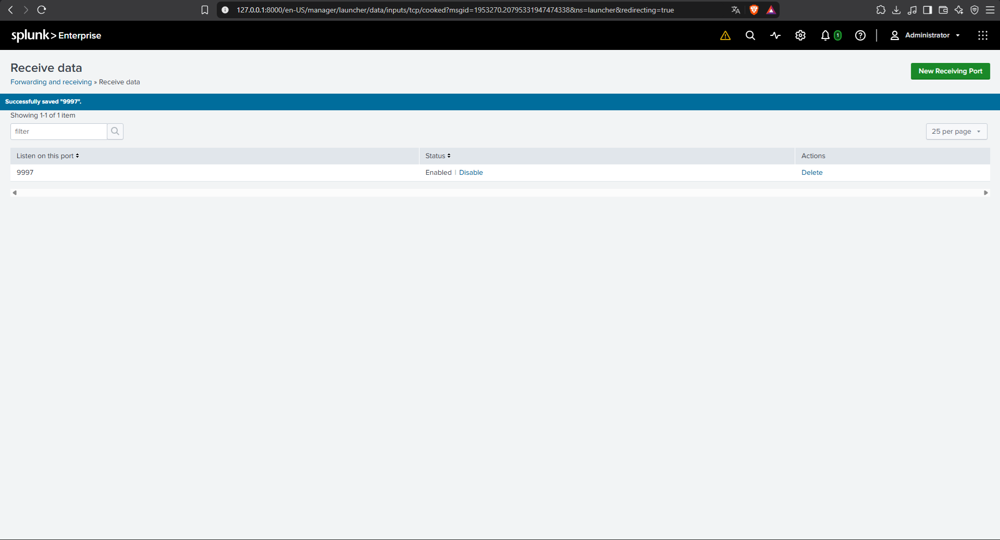
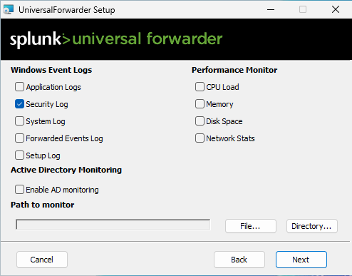
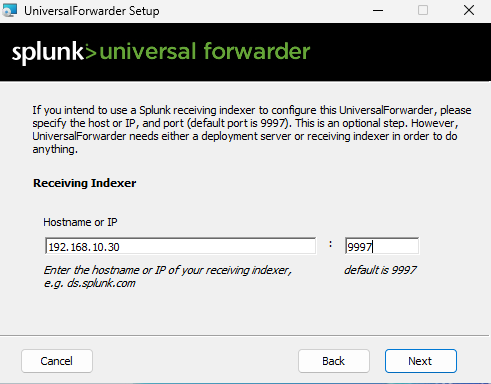
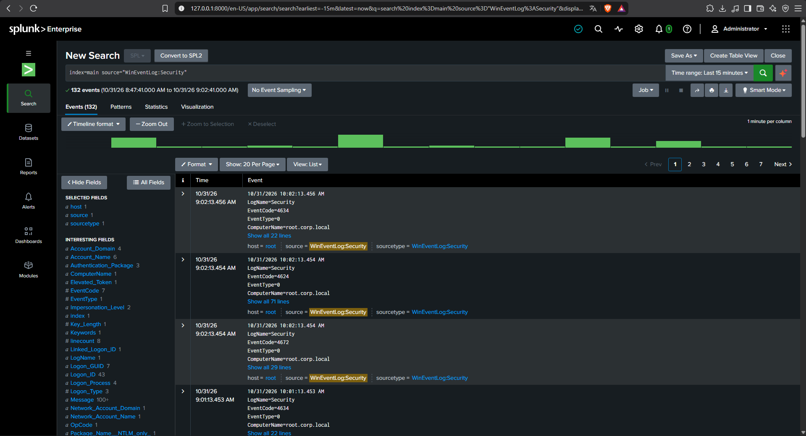
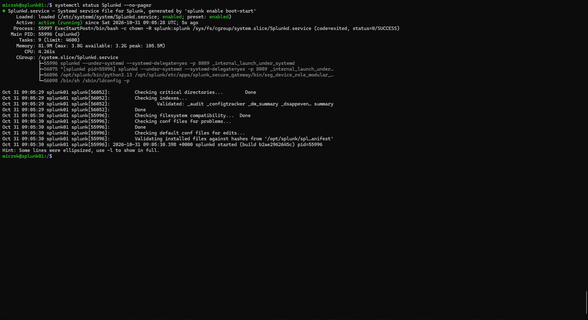

# 07 - Splunk SIEM Setup

This document covers installing Splunk Enterprise on the Splunk01 virtual machine and forwarding the Windows Security log from the Domain Controller to it with the Splunk Universal Forwarder. After this step, the lab has one central place to collect and search logs. The detection searches themselves are built in document 08.

## 1. Design

Logs are stored on a separate machine (Splunk01) instead of on the monitored host. This way, an attacker who gets onto the Domain Controller cannot easily tamper with the evidence.

| Component | Machine | Role | Port |
|---|---|---|---|
| Splunk Enterprise 10.6.1.1 | Splunk01 (`192.168.10.30`) | Receives, stores and searches logs | `9997` (receiving), `8000` (Splunk Web) |
| Universal Forwarder | DC01 (`192.168.10.10`) | Sends the Windows Security log | to `192.168.10.30:9997` |

All log traffic travels over the isolated Internal Network (`intnet`).

**Note on names:** DC01 is the lab's name for the Domain Controller. Its Windows computer name is `root` (`root.corp.local`), so events in Splunk show `host=root`.

## 2. Access to Splunk01 from the Host Computer

The Splunk01 console in VirtualBox does not allow copy and paste, and Splunk Web needs a browser. Both problems are solved with two port forwarding rules on the Splunk01 **NAT adapter** (Settings → Network → Adapter 1 → Advanced → Port Forwarding):

| Name | Protocol | Host address | Host port | Guest port |
|---|---|---|---|---|
| `ssh` | TCP | `127.0.0.1` | `2222` | `22` |
| `splunk-web` | TCP | `127.0.0.1` | `8000` | `8000` |

The host address `127.0.0.1` means only this computer can use these ports — they are not open to the home network. The lab network `intnet` is not affected.

Splunk01 did not have a running SSH server, so it was installed first:

```bash
systemctl is-active ssh
sudo apt update && sudo apt install -y openssh-server
```

From then on, commands were pasted from PowerShell on the host:

```powershell
ssh -p 2222 miczek@127.0.0.1
```

## 3. Installing Splunk Enterprise

Splunk01 had about 4 GB of RAM and 44 GB of free disk space, which is enough for a lab with a small amount of logs.

The installer (`.deb` package for Ubuntu) was downloaded on the host computer and copied to Splunk01 over SSH. The target in `scp` must end with `:/tmp/` — without the colon, `scp` tries to copy the file locally and fails.

```powershell
scp -P 2222 .\splunk-10.6.1.1-b2ae2962645c-linux-amd64.deb miczek@127.0.0.1:/tmp/
```

On Splunk01, the copy was checked and the package was installed:

```bash
ls -lh /tmp/splunk*.deb
sudo dpkg -i /tmp/splunk-*.deb
```

The package installs Splunk into `/opt/splunk`.

## 4. First Start as a Dedicated User

Splunk should not run as `root`. A `splunk` system user already existed on Splunk01, so the installed files were given to it and Splunk was started as that user:

```bash
sudo chown -R splunk:splunk /opt/splunk
sudo -i -u splunk /opt/splunk/bin/splunk start --accept-license
```

On the first start, Splunk asks for an administrator username and password. The characters of the password are not shown while typing. When the start finishes, Splunk prints the address of Splunk Web.



Splunk Web is then available in a browser on the host at `http://127.0.0.1:8000` (through the port forwarding rule from section 2).



## 5. Enabling the Receiving Port

Splunk must listen on a port to accept logs from forwarders. The default port is `9997`. In Splunk Web: **Settings → Forwarding and receiving → Configure receiving → New Receiving Port**.



## 6. Installing the Universal Forwarder on DC01

DC01 is connected only to `intnet` and has no internet access, so the installer cannot be downloaded on it. Giving DC01 a NAT adapter would weaken the isolation of the lab, so Splunk01 was used as a temporary file server inside the lab network instead:

1. The Universal Forwarder 64-bit `.msi` installer was downloaded on the host and copied to Splunk01 the same way as the Splunk package in section 3 (`scp` to `/tmp/`).
2. On Splunk01, a simple web server was started in the folder with the file:

```bash
cd /tmp
python3 -m http.server 8080
```

3. On DC01, the file was downloaded in a browser from `http://192.168.10.30:8080`. After that, the web server on Splunk01 was stopped with `Ctrl+C`.

In the installer wizard, the important settings were:

- **Windows Event Logs:** only **Security Log** is selected. The Security log contains the Kerberos events (such as Event ID 4769) needed to detect Kerberoasting.



- **Deployment Server:** left empty. A deployment server is a different component (port `8089`) and is not used in this lab.
- **Receiving Indexer:** host `192.168.10.30`, port `9997` — this is where the forwarder sends the logs.



- **Administrator account:** a local account of the forwarder itself, with a password chosen by hand. It is not used to log in to Splunk Web.

## 7. Verifying the Log Flow

After the installation, the Security log from DC01 started to arrive in Splunk. This search in Splunk Web (time range: last 15 minutes) confirms it:

```
index=main source="WinEventLog:Security"
```

The search returned 132 events in 15 minutes, all with `host=root` (the Domain Controller). The first events are logon and logoff events (for example Event IDs 4624, 4634 and 4672). This confirms the whole chain works: DC01 → Universal Forwarder → Splunk01.



## 8. Running Splunk as a Service

So that Splunk starts by itself every time Splunk01 boots, it was registered as a `systemd` service that runs as the `splunk` user. The documentation requires stopping Splunk before changing the boot setting:

```bash
sudo -i -u splunk /opt/splunk/bin/splunk stop
sudo /opt/splunk/bin/splunk enable boot-start -systemd-managed 1 -user splunk -group splunk
sudo /opt/splunk/bin/splunk start
systemctl status Splunkd --no-pager
```

- The second command creates the service `Splunkd`.
- The third command starts Splunk again, now as that service.
- The last command shows its state: `enabled` (starts at boot) and `active (running)`.



## Problems Encountered

- **SSH server missing on Splunk01** — `systemctl is-active ssh` returned `inactive`; fixed by installing `openssh-server` (section 2).
- **`scp` copied nothing** — the target had no `:/tmp/` part, so `scp` looked for a local path and reported `0 file(s) copied`. Fixed by adding the colon and the folder.
- **Deployment Server vs. Receiving Indexer** — the forwarder installer has two similar screens. The first one (Deployment Server, port `8089`) must stay empty. The log destination `192.168.10.30:9997` goes only on the Receiving Indexer screen.

## Status

✅ Splunk Enterprise installed on Splunk01 and running as a service under the `splunk` user.

✅ Universal Forwarder installed on DC01; the Windows Security log arrives in Splunk.

**Next step:** Build the detection searches for Kerberoasting (Event 4769) and LLMNR/NBT-NS poisoning in Splunk (see document 08).