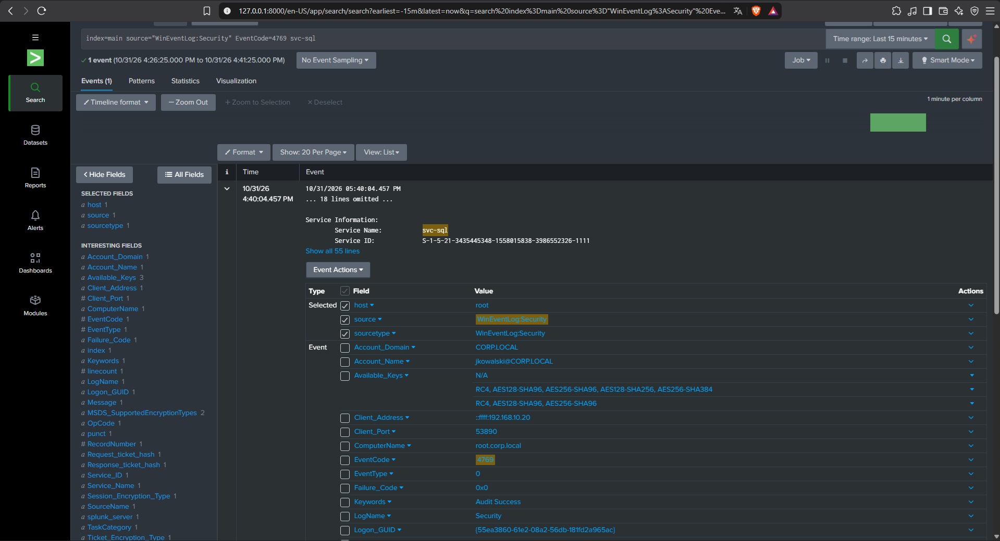
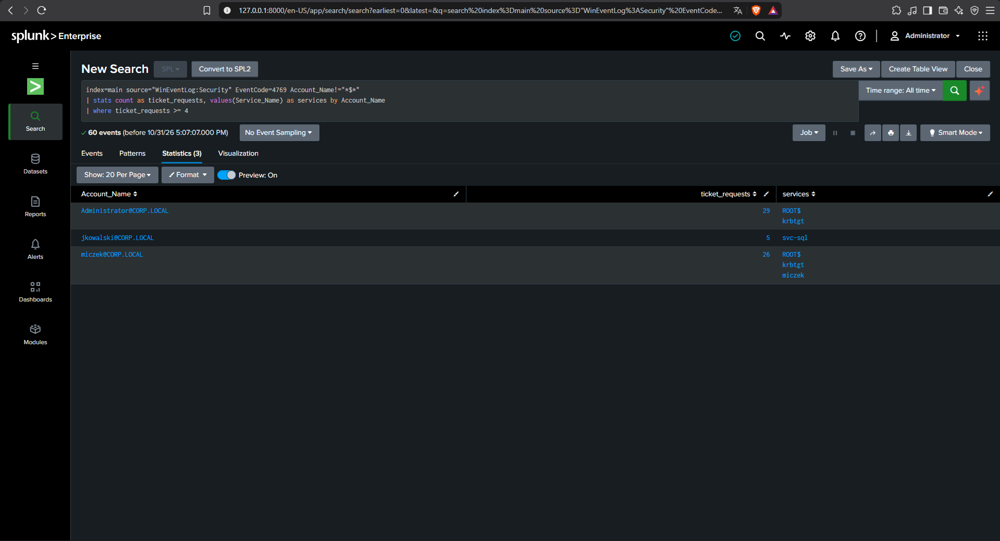
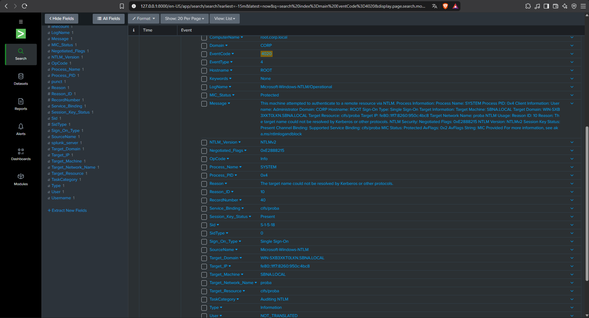
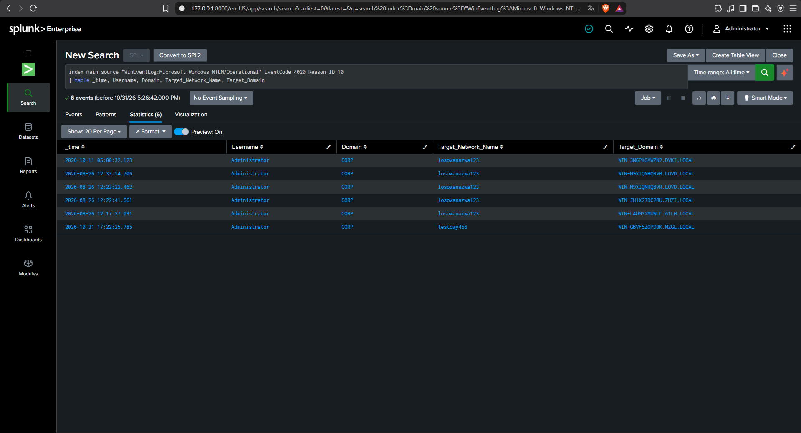

# 08 - Detection in Splunk

This document rebuilds the two detections from `06-Blue-Team-detection-write-up.md` (Kerberoasting and LLMNR/NBT-NS poisoning) as Splunk searches, using the log pipeline set up in `07-Splunk-SIEM-setup.md`. Both attacks were re-run against DC01 to generate fresh events to search for.

## 1. Kerberoasting (Event 4769)

### 1.1 Why Encryption Type Still Doesn't Give It Away

As established in document 06, `svc-sql` has `msDS-SupportedEncryptionTypes=24` (AES only), so the Domain Controller forces AES256 (`Ticket_Encryption_Type=0x12`) for every ticket request for this account — legitimate or not. This still holds true in Splunk: the raw event for the attack shows `Ticket_Encryption_Type: 0x12`, identical to what a legitimate request would show. A search built around the encryption type would miss this attack entirely.

### 1.2 The Attack, Captured as a Raw Event

The Kerberoasting attack from `04-kerberoasting-attack.md` (`impacket-GetUserSPNs ... -request`) was re-run from Kali. The resulting Event 4769 was found in Splunk with:

```
index=main source="WinEventLog:Security" EventCode=4769 svc-sql
```

The event confirms the attack: `Client_Address` is `::ffff:192.168.10.20` (Kali), `Service_Name` is `svc-sql`, and `Account_Name` is `jkowalski@CORP.LOCAL`.



### 1.3 Building a Detection: Count of Ticket Requests per Account

Since encryption type is a dead end, the detection instead reuses the behavioral pattern from document 06: a normal user logs on and is issued tickets for a handful of domain services (`krbtgt`, the Domain Controller's own computer account, occasionally their own account name). An account requesting a service ticket for one specific service — and nothing else — several times in a row is a signal that survives AES-only hardening, because it doesn't depend on the ticket's encryption at all.

```
index=main source="WinEventLog:Security" EventCode=4769 Account_Name!="*$*"
| stats count as ticket_requests, values(Service_Name) as services by Account_Name
| where ticket_requests >= 4
```

- **Line 1** filters to Event 4769 (Kerberos service ticket requests) and excludes computer accounts (`Account_Name!="*$*"`) — machine accounts such as `ROOT$` request tickets for themselves constantly as ordinary domain traffic and would otherwise dominate the results.
- **Line 2** groups the remaining events by account and, for each one, counts how many tickets it requested (`count`) and lists which services it requested them for (`values`).
- **Line 3** keeps only accounts with 4 or more requests.

Run over `All time`, three accounts remain: `Administrator` (29 requests across 2 services — normal domain activity), `miczek` (26 requests across 3 services — normal domain activity), and `jkowalski` (**5 requests, 1 service: `svc-sql`**). The contrast is the detection: a handful of requests concentrated on a single service nobody else touches, instead of the usual spread across domain services.



**Limitation:** this search was run over the entire log history (`All time`), which is fine for a small lab but too loose for production — a legitimate user would also eventually cross the threshold of 4 *different* services over weeks or months. A production version would add a time window (e.g. `earliest=-1h`) and specifically flag accounts where `dc(Service_Name)` is low relative to `count` — many requests, but for very few distinct services — rather than just counting total requests.

## 2. LLMNR/NBT-NS Poisoning (Event 4020)

### 2.1 Locating the Event

Event 4020 (NTLM fallback, used in document 06) does not live in the Security log — it is in a separate Windows event channel, `Microsoft-Windows-NTLM/Operational`. The Universal Forwarder on DC01 was originally configured to forward only the Security log (see document 07), so this channel had to be added as a second input before any of these events could reach Splunk.

In `C:\Program Files\SplunkUniversalForwarder\etc\system\local\inputs.conf`:

```ini
[WinEventLog://Security]
disabled = 0
index = main

[WinEventLog://Microsoft-Windows-NTLM/Operational]
disabled = 0
index = main
```

After editing the file, the forwarder service was restarted to pick up the change:

```powershell
Restart-Service SplunkForwarder
```

### 2.2 Re-triggering the Attack

The LLMNR/NBT-NS mitigation tested and left enabled at the end of document 06 (LLMNR disabled via `EnableMulticast=0`, NetBIOS disabled via `TcpipNetbiosOptions=2`) was still active on DC01, and silently blocked the attack from generating any traffic to detect. Both settings were reverted temporarily:

```powershell
reg add "HKLM\SOFTWARE\Policies\Microsoft\Windows NT\DNSClient" /v EnableMulticast /t REG_DWORD /d 1 /f
reg add "HKLM\SYSTEM\CurrentControlSet\Services\NetBT\Parameters\Interfaces\Tcpip_{<adapter GUID>}" /v NetbiosOptions /t REG_DWORD /d 0 /f
Disable-NetAdapter -Name "Ethernet" -Confirm:$false
Enable-NetAdapter -Name "Ethernet" -Confirm:$false
```

With the mitigation reverted, the attack from `05-llmnr-poisoning-attack.md` was repeated: Responder (`sudo responder -I eth1`) on Kali, and a nonexistent share accessed on DC01 (`ls \\testowy456\test`) to trigger the DNS-resolution failure and LLMNR/NBT-NS fallback. Responder received the authentication attempt, confirming the attack succeeded again with the mitigation off.

Once the detection search below was confirmed working, the mitigation was restored to its document 06 state (`EnableMulticast=0`, `TcpipNetbiosOptions=2`) and re-verified.

### 2.3 The Attack, Captured as a Raw Event

```
index=main EventCode=4020
```

The raw event shows `Reason: "The target name could not be resolved by Kerberos or other protocols."` (`Reason_ID: 10`), `Target_Network_Name: testowy456` (the share name from the triggering command), and `Target_Domain: WIN-GBVF5ZOPD9K.MZGL.LOCAL` — a fabricated domain name supplied by Responder, not the real `CORP.LOCAL`.



### 2.4 Building a Detection: NTLM Fallback After Failed Name Resolution

`Reason_ID=10` is the field that matters: it is set specifically when NTLM is used because Kerberos (or another protocol) could not resolve the target name first — exactly the fallback that LLMNR/NBT-NS poisoning exploits. It filters out any ordinary, legitimate NTLM authentication, which would not carry this reason code.

```
index=main source="WinEventLog:Microsoft-Windows-NTLM/Operational" EventCode=4020 Reason_ID=10
| table _time, Username, Domain, Target_Network_Name, Target_Domain
```

- **Line 1** filters to Event 4020 entries where the reason code is specifically "name could not be resolved."
- **Line 2** lays out the result as a readable table: when it happened, which account authenticated, and what resource it was trying to reach.

Run over `All time`, this returned 6 events across two separate attack sessions (one from `05-llmnr-poisoning-attack.md`, one re-run for this document) — all under the `Administrator` account, each with a different fabricated `Target_Domain` value supplied by Responder.



**Observation:** `Target_Domain` never matches the real domain (`CORP.LOCAL`) in any of the 6 events. In a larger environment, this could be added as a second filter (`Target_Domain!="CORP.LOCAL"`) to further narrow the search, though `Reason_ID=10` alone was already enough to isolate all six events with zero false positives in this lab.

## Status

✅ Kerberoasting detection search built and verified: flags accounts requesting many tickets concentrated on a single service, independent of ticket encryption type.

✅ LLMNR/NBT-NS poisoning detection search built and verified: flags NTLM authentication caused by failed name resolution (`Reason_ID=10`), catching both the original and re-run attack sessions.

✅ The LLMNR/NBT-NS mitigation from document 06 was restored and re-verified as enabled on DC01 after testing.

**Next step:** none currently planned — this closes out the attack/detection cycle for Kerberoasting and LLMNR/NBT-NS poisoning in this lab.